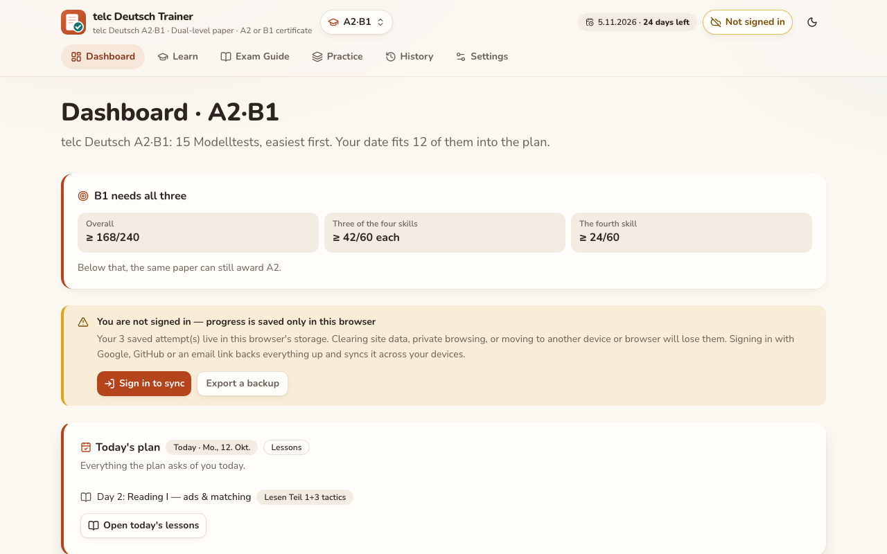
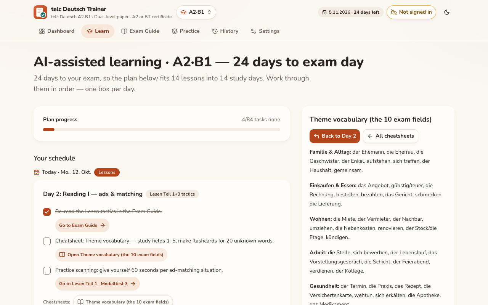
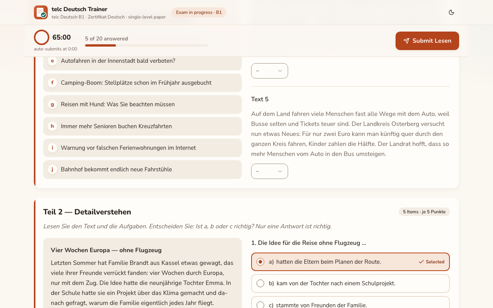
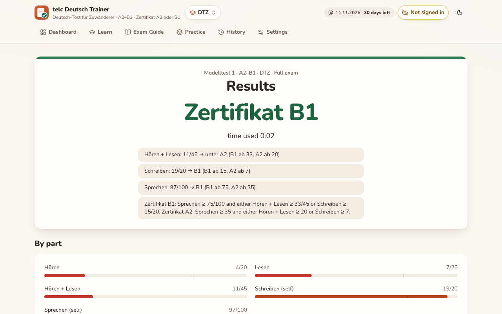
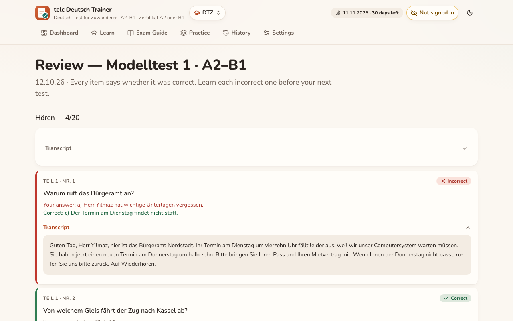
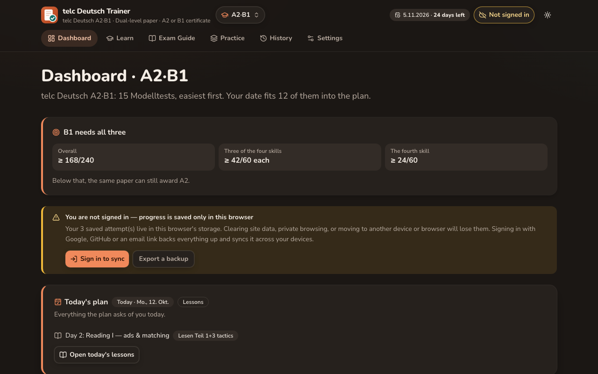
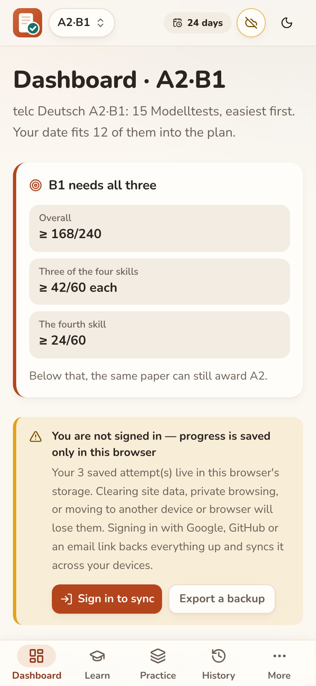
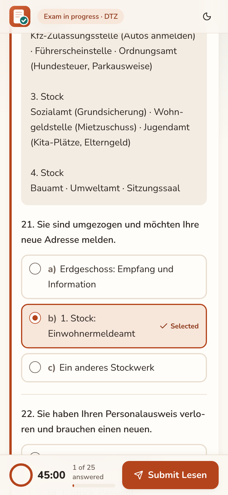

<div align="center">
  
  <h1>telc Deutsch Trainer</h1>
  <p><strong>Four German exams — telc A2·B1, B1, B2 and the DTZ — 45 complete mock exams under real timing, marked by the official weighting.</strong></p>
  <p>
    <a href="https://github.com/prangonsafayet/telc-a2b1-trainer/actions/workflows/ci.yml"></a>
    
  </p>
  <p>
    
    
    
    
    
    
  </p>
</div>

---

I built this to sit the telc Deutsch A2·B1 exam, then grew it to cover telc B1 and
B2 as well, and now the DTZ — the Deutsch-Test für Zuwanderer A2–B1. Practice material for these exams is thin, and the material that
exists does not simulate the thing that actually makes them hard: doing every
module back to back, on the clock, with the listening audio playing twice and no
more.

So this is the exam, not a quiz app. Real time limits per module, automatic
submission when time runs out, a limited number of audio plays, and the official
grading rule for each paper — A2·B1's four-skill dual-level paper
(**B1 certificate = ≥42/60 in three skills plus ≥24/60 in the fourth**, 240 points)
telc B1/B2's shared single-level paper (**written 225 + oral 75 = 300**,
60% needed per section), and the DTZ paper, which places you at **Zertifikat A2 or B1**
from three Teilergebnisse — Hören/Lesen, Schreiben and Sprechen.

## What it does

- **Four peer trainers, one app.** telc Deutsch A2·B1, telc B1, telc B2 and the DTZ
  each have their own exams, study plan, guide and vocabulary bank, switchable from
  one header control. Fifteen A2·B1 Modelltests plus ten each for B1, B2 and DTZ — 45
  full exams in total, from early A2 to upper B2, covering every module of their
  paper: Leseverstehen, Sprachbausteine (where the paper has it), Hörverstehen,
  Schreiben, Sprechen.
- **Real exam conditions.** Per-module countdowns that auto-submit, a play budget
  per listening item, and no preparation time in the speaking module.
- **Refresh-safe attempts.** The running exam — current module, every answer, the
  remaining time and the audio plays used — is written to browser storage as you
  go. Reload the tab, or come back after closing it, and it resumes exactly where
  you were.
- **Official scoring**, plus guided self-assessment for the two modules a human
  has to grade, against sample answers and telc-style criteria.
- **Full review** of any past attempt: every answer against the correct one, with
  the listening transcripts revealed only afterwards.
- **A study plan that adapts to your exam date.** Tell it when you sit the exam
  and it lays out one dated day at a time: each trainer's own 28-day curriculum,
  with cheatsheets and copy-paste prompts that turn any AI chat into a tutor,
  examiner or speaking partner, then its mock exams. Three weeks left and it
  compresses the essentials and offers the rest as optional; three months and it
  spreads everything out with review days between. Five days and it becomes an
  emergency sprint. Nothing is ever hidden — only re-paced.
- **Vocabulary and grammar practice.** Each trainer has its own bank — around 385
  items for A2·B1, and again for each of telc B1 and B2 — drilled as flashcards,
  quiz questions and reference tables, scheduled by spaced repetition rather than
  shown once and forgotten.
- **Progress that follows you.** Optional cloud sync behind Google, GitHub or
  email + password; without it everything stays local, and the app says so
  clearly rather than letting you assume otherwise.
- A redesigned UI built on design tokens, in light and dark mode,
  keyboard-accessible throughout, and a deep-linkable URL for every screen.

## Screens



<table>
  <tr>
    <td colspan="2"></td>
  </tr>
  <tr>
    <td colspan="2"><strong>The plan</strong> — the curriculum laid out as dated days from today, re-paced whenever the exam date changes. Each task links to where it is done, and cheatsheets open beside the plan.</td>
  </tr>
  <tr>
    <td width="50%"></td>
    <td width="50%"></td>
  </tr>
  <tr>
    <td><strong>Exam runner</strong> — on a tablet in landscape or a desktop, the text sits beside its questions. Answers are large option cards in real radio groups, and the timer is spoken only at 10, 5 and 1 minutes.</td>
    <td><strong>Results</strong> — the verdict, announced once to a screen reader. The DTZ shows its certificate and the three part results it is judged on.</td>
  </tr>
  <tr>
    <td></td>
    <td></td>
  </tr>
  <tr>
    <td><strong>Review</strong> — every item says in words whether it was correct; listening transcripts are revealed only now.</td>
    <td><strong>Dark mode</strong> — follows the system, with a toggle, and no flash on load.</td>
  </tr>
  <tr>
    <td></td>
    <td></td>
  </tr>
  <tr>
    <td><strong>On a phone</strong> — a bottom tab bar for the daily screens; nothing scrolls sideways at 360px.</td>
    <td><strong>Exam on a phone</strong> — the text stays above its items, and the timer, progress and Submit sit at the bottom, within thumb reach.</td>
  </tr>
</table>

## Engineering notes

The interesting parts, for anyone reading the code:

**Feature-sliced architecture with enforced boundaries.** `src/app` is the
composition root and nothing else — entry point, providers, router; the header,
nav and layout are a feature like any other (`features/app-shell`).
`src/features` holds vertical slices, each with its screens in `pages/`; a feature
imports only itself and `src/shared`, never another feature, so anything two
features need — the progress store, the study schedule, account sync, the exam-run
machinery — lives in `src/shared`. Every component sits in its own folder with the
hooks, utils and types only it uses (`DashboardPage/DashboardPage.tsx`,
`DashboardPage/useDashboardStats.tsx`), and there are no barrels: every import
names a file. `src/content/<trainer>/` is inert data. The dependency rules are
ESLint rules and a tree check (`npm run check:architecture`), not documentation.
Wiring this up surfaced two real import cycles, one of which was hanging a route.

**Four trainers behind one registry.** telc Deutsch A2·B1, B1, B2 and the DTZ are
peers described once in `shared/config/trainers.ts` — one descriptor per trainer
names its route, its paper and where its content lives — so every screen, route and
nav item is generated from that list rather than hand-duplicated per trainer. The
papers themselves (dual-level for A2·B1, single-level for B1/B2, and the DTZ paper)
are format descriptors that plug into one exam runner, results screen and review
screen.

**Components are visual; logic is in hooks and utils.** The exam state machine
lives in `useExamRun`; each paper's own score derivation and review construction
live in its format descriptor (`features/mock-exam/lib/formats/{dual-level,single-
level,dtz-paper}/summary.ts` and `review.ts`). A component that renders a screen reads a
hook and maps over data.

**Strict TypeScript**, including `noUncheckedIndexedAccess` and
`exactOptionalPropertyTypes`, with no `any` and no non-null assertions. The exam
data files are checked against the domain types with `satisfies`, so a malformed
Modelltest fails the build rather than the exam.

**Content is split and lazy-loaded per trainer.** Each trainer's exams,
curriculum, guide and vocabulary bank load through one dynamic `import()`, so
visiting one trainer never downloads another trainer's content —
verified in a real browser via the network log, not just by chunk names in the
build report.

**Two test layers, because they catch different things.** Vitest runs the pure
logic in Node and the mounted app in happy-dom — 1,212 assertions across 39 files
in a few seconds, including a sweep of the schedule engine across every runway
length from five days to ninety, and a check that an attempt survives a
mid-module reload with its clock still running. Playwright covers what no DOM
emulation can judge: layout at three breakpoints, dark-mode persistence, popover
positioning, and that the OAuth handoff is really PKCE rather than an implicit
flow. Between them they caught an infinite render loop that only reproduced on
machines with no German text-to-speech voice installed, a timer that stalled
whenever you typed, and a long study plan that banked nine review days in a row
instead of spacing them.

**Auth done carefully.** PKCE so no token ever lands in a URL, a redirect target
built from the page's own origin, row-level security scoping every row to
`auth.uid()`, and a build-time guard that refuses to ship a secret key. Passwords
are Supabase's business — nothing is hashed or stored in the browser.

**Accessibility and motion.** shadcn/ui over Radix primitives throughout, no raw
interactive elements in feature code, and every animation behind
`prefers-reduced-motion` — an exam timer is not the place to fight the interface.

## Quality gates

Every gate runs in CI on each pull request; the fast, offline ones also run before a push.

| Gate                            | Command                                                                                |
| ------------------------------- | -------------------------------------------------------------------------------------- |
| Typecheck (strict)              | `npm run typecheck`                                                                    |
| Lint, zero warnings             | `npm run lint -- --max-warnings=0`                                                     |
| Accessibility lint              | jsx-a11y's strict preset, inside lint                                                  |
| Architecture                    | layer boundaries and components-visual-only in lint, plus `npm run check:architecture` |
| Design tokens                   | raw colours refused in lint and `npm run check:css`                                    |
| Formatting                      | `npm run format:check`                                                                 |
| Exam-data validation            | `npm run validate`                                                                     |
| Unit and render tests           | `npm run test:unit` (Vitest, Node + happy-dom)                                         |
| End-to-end                      | `npm run test:e2e` (Playwright)                                                        |
| Production dependency audit     | `npm run audit:prod`                                                                   |
| Persisted storage-key invariant | `npm run check:storage-keys`                                                           |
| Claude Code guardrail hooks     | `npm run test:hooks`                                                                   |

`npm run guards` runs the architecture, token, storage-key, hook and audit gates together.
Two more report without blocking until their findings are cleared: the dev-dependency audit
(`npm run audit:all`) and dead-code detection with knip (`npm run knip`).

## Working with Claude Code

The repo is set up for Claude Code. [`CLAUDE.md`](CLAUDE.md) stays short; the detail lives in
path-scoped rules under `.claude/rules/` that load only when matching files are touched
(architecture, conventions, UI and design system, persistence, exam formats, content, dates and
timers, testing, tooling). Project agents in `.claude/agents/` author exam content, check exam
facts, review UI and conventions, design the UI and guard persisted data, each with its own
memory, and a shared trap ledger in `.claude/memory/` keeps lessons from being re-learned.
Skills cover verification, auditing, adding an exam or a trainer, and shipping. Hooks block
commits to `main`, AI attribution, whole-tree staging and lockfile edits, and re-check the
storage keys and lint after every edit. A model-routing rule sends lookups and mechanical work
to cheaper models and keeps the strongest one for architecture and persisted-data decisions.

## Architecture docs

[`docs/architecture/`](docs/architecture/README.md) — C4 diagrams (context, containers,
components, dynamic flows), the persisted data model, the quality-gate pipeline and the
decision records behind the rules.

## Running it

Node 24+.

```bash
npm install
npm run dev          # http://localhost:5173
```

| Command            | Purpose                                                   |
| ------------------ | --------------------------------------------------------- |
| `npm run build`    | Production build into `dist/`                             |
| `npm test`         | Typecheck, lint, validate exam data, Vitest suites        |
| `npm run test:e2e` | Playwright (needs `npx playwright install chromium` once) |
| `npm run test:all` | Everything                                                |

Cloud sync is optional. Copy `.env.example` to `.env` and fill in a Supabase
project URL and publishable key to enable it; leave it out and the app runs fully
offline on browser storage.

```dotenv
VITE_SUPABASE_URL=https://<project-ref>.supabase.co
VITE_SUPABASE_ANON_KEY=<anon / publishable key>
VITE_AUTH_PROVIDERS=google,github
VITE_SITE_URL=https://your-deployment-url
```

`VITE_*` values are inlined at build time, so changing one needs a rebuild. The
Settings page reports exactly what the running build was compiled with, which
turns "why is sync off?" into a five-second answer.

## Notes

- Listening uses the browser's German text-to-speech; Chrome and Edge ship a good
  voice. Transcripts stay hidden until the review.
- The speaking module can record you locally so you can listen back. Recordings
  live in the tab and are never uploaded.
- In the A2·B1 dual-level paper, Sprachbausteine is tracked separately, since in
  the real exam it feeds the reading and writing subtests rather than forming its
  own 60-point skill.
- `npm run validate` checks all 45 exam files. [`CLAUDE.md`](CLAUDE.md) documents
  the architecture and conventions, [`CONTRIBUTING.md`](CONTRIBUTING.md) the
  issue → branch → PR → release workflow, [`SECURITY.md`](SECURITY.md) how auth and data
  are protected, and [`CODE_OF_CONDUCT.md`](CODE_OF_CONDUCT.md) how to behave here.

---

<div align="center"><sub>Viel Erfolg bei der Prüfung 🍀</sub></div>
