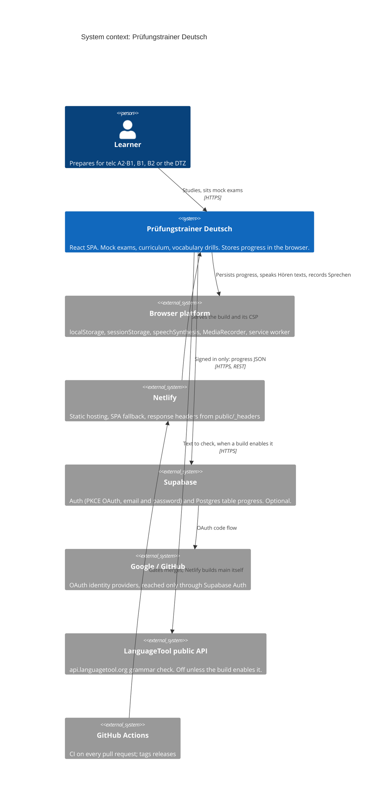

# C4 level 1: system context

The learner uses a single-page app. There is no backend of our own. Every outside system
is optional at runtime except the static host, and the host is only needed for the first
visit after a deploy.

## Relationships

| From → to                | Why                            | What data crosses                                                                                                                                                                                                                                                                                                                                                                                                                                   |
| ------------------------ | ------------------------------ | --------------------------------------------------------------------------------------------------------------------------------------------------------------------------------------------------------------------------------------------------------------------------------------------------------------------------------------------------------------------------------------------------------------------------------------------------- |
| Learner → app            | All study and exam work        | Nothing leaves the device by default.                                                                                                                                                                                                                                                                                                                                                                                                               |
| App → browser platform   | Storage, audio and offline use | The progress document (`telcTrainerV1`), the in-progress runs, the auth session, the theme and the recovery copy in `localStorage`. A diagnostics log and the stale-chunk guard in `sessionStorage`. Hören texts go to `speechSynthesis` (the app ships no audio files). Sprechen recordings stay in a `blob:` URL for the session and are never stored or uploaded. The service worker precaches the build (v3.0.0).                               |
| Netlify → app            | Hosting                        | `dist/` plus the headers in `public/_headers`: CSP, HSTS, `nosniff`, `X-Frame-Options: DENY`, `Permissions-Policy` (`microphone=(self)` only) and `Cross-Origin-Opener-Policy`. `netlify.toml` builds and rewrites `/*` to `/index.html`, and sets no headers.                                                                                                                                                                                      |
| App → Supabase           | Optional cross-device sync     | **Only when signed in.** The whole progress document is one `jsonb` row in `public.progress`, keyed by `user_id`. Row-level security limits each user to their own row. The anon/publishable key is the only key in the bundle. The build (`supabaseEnvCheck` in `vite.config.ts`) and `supabaseClient.ts` both refuse a `sb_secret_` or `service_role` key. Passwords go straight to Supabase Auth, and the app never stores, hashes or logs them. |
| Supabase → Google/GitHub | OAuth                          | The learner's consent happens on the provider's page. The app gets back a single-use PKCE code that only the browser holding the verifier can exchange.                                                                                                                                                                                                                                                                                             |
| App → LanguageTool       | Writing feedback (opt-in)      | **Off unless the build sets `VITE_DYNAMIC_FEEDBACK=true`.** `src/shared/lib/languageToolClient.ts` (`checkText`) then posts the text to check, with no key and no account, to `https://api.languagetool.org` or a `VITE_LANGUAGETOOL_URL` override. **In this tree no screen calls `checkText` yet.** The client, its tests and the CSP `connect-src` entry are ready for the screen that will.                                                     |
| GitHub Actions → Netlify | Quality gate                   | CI never deploys. Netlify builds `main` and every pull request itself (deploy previews, `netlify.toml`). Branch protection lets a change reach `main` only through green CI. See [quality gates](quality-gates.md).                                                                                                                                                                                                                                 |

## What the app is not

- **No backend or API of our own.** Netlify serves static files only. There are no
  functions and no edge functions.
- **No telemetry.** Errors go to a local, redacted log. It leaves the device only when the
  learner copies it from Settings → Diagnostics ([ADR 0010](adr/0010-error-handling-model.md)).
- **No third-party fonts, scripts or analytics.** The CSP has `script-src 'self'` plus one
  hash for the pre-paint theme script, and `font-src 'self'`
  ([ADR 0008](adr/0008-self-hosted-fonts-strict-csp.md)).
- **No official exam material.** The DTZ format follows the g.a.s.t. _Übungssatz 1_ (June
  2024). Every mock exam is original text written to that format.
