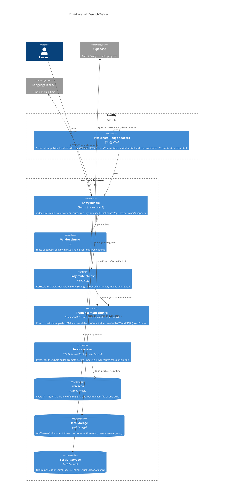

# C4 level 2: containers

Everything runs in the learner's browser. Containers here are the deployable pieces the
build produces (`vite.config.ts`), the stores they write to, and the outside services.

## The containers

### Entry bundle

`index.html` loads `src/app/main.tsx`. Before React renders, an inline script reads
`telcTrainerTheme` to set the theme without a flash. Its SHA-256 is the only hash in
`script-src`. `main.tsx` installs the global error handlers. In a production build it
also calls `registerServiceWorker()`. Then it renders `AppProviders` around `AppRouter`.

The entry chunk holds what every screen needs synchronously:

- the registry `src/shared/config/trainers.ts` and each trainer's small `content/<id>/paper.ts`;
- the app shell (`features/app-shell`);
- `DashboardPage`, the landing screen.

`npm run check:bundle` fails when the entry chunk grows past `ENTRY_BASELINE_BYTES` + 10%.

### Vendor chunks

`manualChunks` in `vite.config.ts` puts `react`, `react-dom` and `react-router` in a `react`
chunk and `@supabase/*` in a `supabase` chunk. A release that changes only app code then
leaves both cached. The `supabase` chunk still loads at boot: `AppLayout` →
`useAppLayout` → `useCloudSync` imports the client. When `VITE_SUPABASE_*` is missing,
the client is `null` and makes no request.

### Lazy route chunks

`src/app/router.tsx` keeps `DashboardPage`, `AppLayout` and `NotFoundPage` eager. Every
other screen is `React.lazy`. One router `<Suspense>` with `RouteFallback` covers them all.
Every trainer gets the same route set under its `basePath`:

- `''` (A2·B1 owns the root), `/b1`, `/b2`, `/dtz`;
- `learn`, `guide`, `practice`, `history`;
- `exam/:examId/:mode`, `results/:attemptId`, `review/:attemptId`.

`/settings` sits outside every trainer.

### Trainer content chunks

`TRAINERS[id].loadContent` is a dynamic `import('@content/<id>/content.ts')`. `manualChunks`
names the chunk `content-<id>`. It matches every file under `src/content/<id>/` except
`paper.ts`, which the registry and the format descriptors import eagerly.
`useTrainerContent` caches one promise per trainer and suspends on it with React `use()`. A
failed load is forgotten, so "Try again" fetches the chunk again. A visitor downloads only
the trainers they open. `check:bundle` caps each content chunk at 160 kB gzip.

### Service worker and precache (added in v3.0.0)

`VitePWA` in `vite.config.ts` builds a Workbox `sw.js` with the runtime inlined, so there is
no `workbox-*.js`. Its settings:

| Setting            | Value and effect                                                                                                                              |
| ------------------ | --------------------------------------------------------------------------------------------------------------------------------------------- |
| `registerType`     | `'prompt'`. A new build waits until the learner clicks Reload.                                                                                |
| `injectRegister`   | `false`. `src/shared/lib/serviceWorker.ts` registers the worker, so the CSP needs no inline script.                                           |
| `manifest`         | `false`. `public/manifest.webmanifest` is hand-written.                                                                                       |
| `globPatterns`     | `**/*.{js,css,html,woff2,svg,png,webmanifest}`. This includes all four `content-<id>` chunks, so every trainer works offline after one visit. |
| `globIgnores`      | `og-image.png` and the Cyrillic/Vietnamese font subsets.                                                                                      |
| `clientsClaim`     | `true`. The first visit is controlled at once.                                                                                                |
| `navigateFallback` | `index.html`. Not used for `/assets/` or any path with a file extension, so a missing chunk still 404s and the stale-chunk guard can see it.  |
| `runtimeCaching`   | None. Supabase and LanguageTool are cross-origin, so they always go to the network.                                                           |

The shell offers an update as a sonner toast (`useUpdatePrompt`), and never on the exam
runner route (`isExamRunPath`). `public/_headers` serves `/sw.js` with `no-cache`, so each
update check sees the latest worker.

### Browser stores

| Store            | Keys                                                                                                     | Written by                                                                     |
| ---------------- | -------------------------------------------------------------------------------------------------------- | ------------------------------------------------------------------------------ |
| `localStorage`   | `telcTrainerV1` (the progress document)                                                                  | `ProgressProvider` through `progressDb.persistDatabase` → `storage.writeLocal` |
|                  | `telcTrainerRunV1`, `telcTrainerLevelRunV1`, `telcTrainerDtzRunV1` (runs in progress, one key per paper) | `createRunStore` in `shared/exam-run/lib/runStore.ts`                          |
|                  | `telcTrainerAuth` (Supabase session, plus the PKCE verifier during a sign-in)                            | supabase-js (`storageKey` in `supabaseClient.ts`)                              |
|                  | `telcTrainerTheme`                                                                                       | `useTheme.tsx`, and read by the inline script in `index.html`                  |
|                  | `telcTrainerRecoveryV1` (byte-for-byte copy of a document that could not be read)                        | `progressDb.loadDatabase`                                                      |
| `sessionStorage` | `telcTrainerSessionLogV1` (last 100 redacted log entries, per tab)                                       | `shared/lib/logger.ts`                                                         |
|                  | `telcTrainerChunkReloadAt` (time of the last automatic reload)                                           | `shared/lib/staleChunk.ts`                                                     |
| Cache Storage    | Workbox precache                                                                                         | the service worker                                                             |

Every key above is in `.claude/hooks/storage-keys.baseline`. See the
[data model](data-model.md).

### Supabase

The browser reaches Supabase only through `supabaseClient.ts`, and only when the build has a
valid URL and a non-secret key (`isSyncConfigured`). The schema is in `supabase-setup.sql`:
one table, `public.progress (user_id uuid primary key, data jsonb, updated_at timestamptz)`.
Row-level security has select, insert and update policies for `auth.uid() = user_id`. There
is no realtime channel, so the CSP allows no `wss:`.

### LanguageTool

`languageToolClient.ts` POSTs to `<base>/v2/check`. It caches results, limits text length
(`LANGUAGE_TOOL_MAX_CHARS`) and times out (`LANGUAGE_TOOL_TIMEOUT_MS`). It returns a typed
result: `ok` or `unavailable` with a reason (`not-configured`, `rate-limited`, `too-long`,
`offline` or `error`). It never throws. The build disables it unless
`VITE_DYNAMIC_FEEDBACK` is set.

### Netlify edge

`public/_headers` is the only source of response headers; `netlify.toml` sets none. Each
CSP directive and the reason for it are in `.claude/rules/tooling-ci.md`. Two checks hold
the CSP to the build:

- `npm run check:csp` checks that the `script-src` hash matches the built inline script.
- `npm run test:csp` serves `dist/` with the real headers and fails on any CSP violation.
