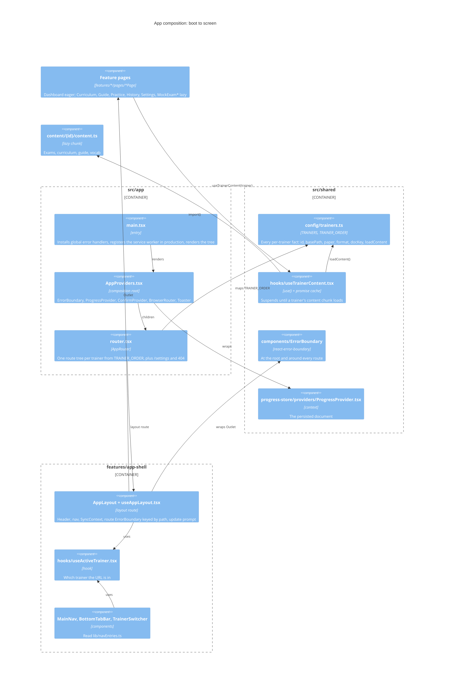
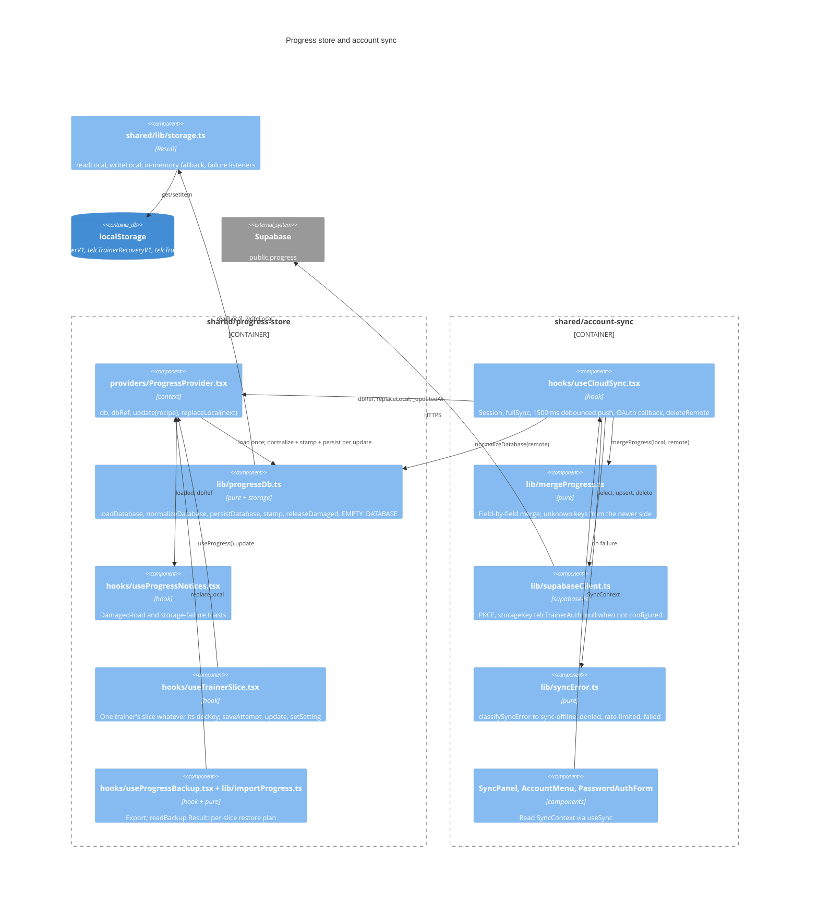
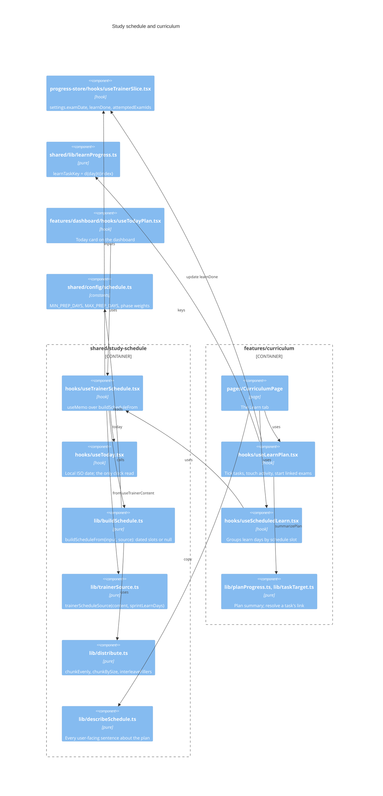
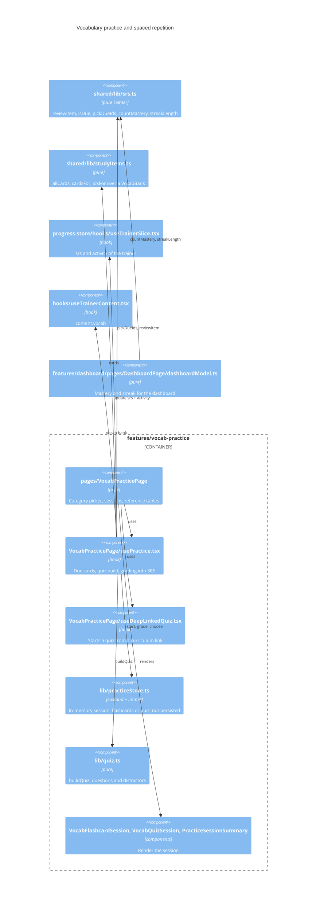
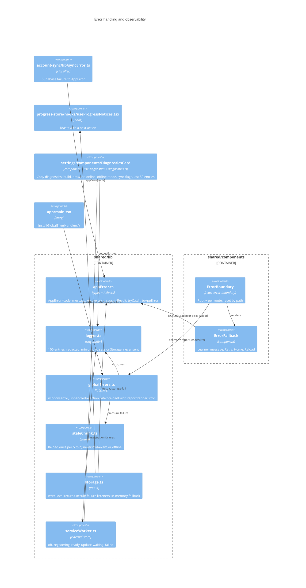

# C4 level 3: components

One diagram per area. Each box names the file that defines it, relative to `src/`. The
layer rules apply throughout:

- `app/` composes and may import anything.
- A feature imports only itself, `@shared` and `@content`.
- `shared/` imports no feature.
- `content/` imports only `@shared/types`.

Both ESLint and `npm run check:architecture` enforce these rules.

- [a. App composition](#a-app-composition)
- [b. Mock-exam engine](#b-mock-exam-engine)
- [c. Progress store and account sync](#c-progress-store-and-account-sync)
- [d. Study schedule and curriculum](#d-study-schedule-and-curriculum)
- [e. Vocabulary practice and SRS](#e-vocabulary-practice-and-srs)
- [f. Error handling and observability](#f-error-handling-and-observability)

## a. App composition

- **Order matters in `AppProviders`.** The error boundary is outermost, so a crash anywhere
  still renders. The progress provider sits above the router, so navigation never remounts
  it.
- **The router names no trainer.** `trainerRoutes(trainer)` builds a dashboard, `learn`,
  `guide` (only when `hasGuide`), `practice`, `history` and the three exam routes. Every
  page gets `trainer` as a prop.
- **The layout owns cloud sync.** `useAppLayout` calls `useCloudSync` and provides the
  result on `SyncContext`. `AccountMenu` in the header and `SyncPanel` in Settings both read
  it through `useSync`.
- **The runner route is distraction-free.** On it, the layout hides the nav, the trainer
  switcher, the countdown and the account menu. `isExamRunPath` in
  `shared/exam-run/lib/examMode.ts` decides this. The update prompt and the stale-chunk
  guard read the same function.

## b. Mock-exam engine

```mermaid
C4Component
  title Mock-exam engine: one runner, three papers

  Container_Boundary(mock, "features/mock-exam") {
    Component(pagesX, "MockExamRunnerPage, MockExamResultsPage, MockExamReviewPage", "pages", "Take trainer as a prop")
    Component(binding, "hooks/useExamBinding.tsx", "hook", "Trainer to format, papers and attempt store; switch on slice.format")
    Component(runner, "ExamRunnerView + useExamRun.tsx", "state machine", "brief, module, rating; clock; answers; plays; finish")
    Component(dual, "lib/formats/dual-level/format.ts", "DUAL_LEVEL_FORMAT", "A2·B1: 5 modules, sb score, dual verdict")
    Component(single, "lib/formats/single-level/format.ts", "SINGLE_LEVEL_FORMAT", "B1, B2: 5 modules, written + oral parts")
    Component(dtz, "lib/formats/dtz-paper/format.ts", "DTZ_FORMAT", "DTZ: 4 modules, 3 Teilergebnisse, certificate")
    Component(scoring, "formats/*/attempt, scoring, summary, review.ts", "pure", "buildAttempt, summarize, review, countUnanswered")
    Component(renderers, "components/modules/{format}/*Module", "renderers", "One per module per paper; imported only by their format.ts")
    Component(rating, "components/rating/SelfRatingCard", "component + useSelfRating", "Criteria sliders for Schreiben and Sprechen")
    Component(results, "AttemptResults, AttemptReview", "components", "Render AttemptSummary and ReviewSection lists")
  }

  Container_Boundary(examRun, "shared/exam-run") {
    Component(runFormats, "lib/runFormats.ts", "RUN_FORMATS", "Run-only half of each format; runFormatFor, clearAllRuns")
    Component(runStore, "lib/runStore.ts", "createRunStore", "parseRuns, legacy envelopes, one entry per trainer per key")
    Component(start, "hooks/useStartAttempt.tsx", "hook", "Start, resume or confirm-replace a run; used by dashboard and curriculum")
  }

  Component(slice, "progress-store/hooks/useTrainerSlice.tsx", "hook", "settings, attempts, saveAttempt for the trainer's slice")
  Component(examUi, "shared/components/exam-ui/*", "components", "Inputs, gaps, toolbar, CountdownRing, RecorderControls")

  Rel(pagesX, binding, "useExamBinding(trainer)")
  Rel(binding, slice, "reads format, attempts")
  Rel(binding, dual, "picks")
  Rel(binding, single, "picks")
  Rel(binding, dtz, "picks")
  Rel(pagesX, runner, "renders")
  Rel(runner, runStore, "load, save, clear")
  Rel(runner, renderers, "format.moduleComponents[module]")
  Rel(runner, rating, "phase rating")
  Rel(runner, scoring, "buildAttempt at finish")
  Rel(runner, slice, "saveAttempt")
  Rel(pagesX, results, "summarize, review")
  Rel(dtz, runFormats, "spreads DTZ_RUN_FORMAT")
  Rel(runFormats, runStore, "one store per key")
  Rel(start, runFormats, "runFormatFor")
  Rel(renderers, examUi, "imports by file")

  UpdateLayoutConfig($c4ShapeInRow="4", $c4BoundaryInRow="1")
```

The descriptor type is `ExamFormat<TExam, TSettings, TAttempt>` in
`shared/exam-run/types/examFormat.ts`. It extends `ExamRunFormat` (`modules`,
`moduleShort`, `runStore`) with:

- `examLabel`, `moduleName`, `minutes` and `briefing`;
- `rating`: a `RatingSpec` per rated module, with a `stepPoints` override for the unequal DTZ
  oral scales;
- `speakingHint` and `speakingReviewNote`;
- `moduleComponents`: a `Partial` record, because the DTZ has no Sprachbausteine;
- `scoring`: an `ExamScoring` with `countUnanswered`, `buildAttempt`, `summarize`,
  `completionToast`, `review` and `writingSample`.

The runner, the results screen and the review screen exist once and read everything
paper-specific through this object ([ADR 0002](adr/0002-format-descriptors.md)).

The run store is shared, not owned by the feature, because two other features start and
discard runs: the dashboard (`useResumableRun`, `useStartAttempt`) and settings
(`clearAllRuns` on "Delete all progress"). Each paper has its own key, and inside a key
each trainer has its own entry. B1 and B2 share `telcTrainerLevelRunV1` without
overwriting each other.

## c. Progress store and account sync

- **Two ways to write the document.**
  - `update(recipe)` normalizes the result, stamps `_updatedAt` and persists it. A new stamp
    is what triggers the debounced push.
  - `replaceLocal(next)` normalizes and persists without restamping. Sync uses it to install
    a merged document, so the two sides do not fight over which one is newer.
- **`normalizeDatabase` is not a whitelist.** It spreads the input first and then validates
  each field it knows. A field written by a newer build survives an older build. It keeps
  a nested object's identity when nothing in it changed, because it runs on every write
  ([ADR 0004](adr/0004-no-schema-library.md)).
- **`mergeProgress` rebuilds every known field.** Unknown fields come from the newer side.
  The rule for each field is in the [data model](data-model.md#merge-rules)
  ([ADR 0003](adr/0003-local-first-field-merge.md)).
- **One sync per sign-in, then debounced pushes.** A push never runs before a pull has
  succeeded. Until then, the debounced timer retries the full sync instead.

## d. Study schedule and curriculum

The schedule is **derived on every render and never stored**. `buildScheduleFrom` is pure:
`today` is an argument and the engine reads no clock. Its only stored inputs are:

- `settings.examDate`;
- `learnDone`;
- the attempted exam ids.

So the plan can never disagree with progress. A stored date that is not a real date
returns `null`, and callers then show static copy rather than a plan built on a guess.

- **Runway.** The engine clamps the runway to `MIN_PREP_DAYS` (5) to `MAX_PREP_DAYS` (90)
  and splits it into a learn phase and a mock phase.
- **Tier rule.** Core days 1–14 are always scheduled. Extension days 15–28 appear only once
  every core day has a day of its own.
- **Sprint.** The shortest runway is the emergency sprint: a crash course on the trainer's
  `sprintLearnDays`, three anchor papers (`sprintAnchors`) and an exam eve. With even fewer
  days, it is trimmed from the middle.
- **Tests.** The sweep in `tests/unit/schedule.test.ts` holds these invariants across every runway.

## e. Vocabulary practice and SRS

`srs.ts` is a small Leitner system:

- six boxes with intervals `[0, 1, 3, 7, 14, 30]` days;
- a miss sends an item back to box 1;
- box 4 and above counts as mastered.

Like the schedule, it is pure: `today` is always an argument. The session itself (which
card is open, quiz choices) lives in a zustand store with immer. It is deliberately not
persisted, and only the graded result reaches the document. Each trainer keeps its own
`srs` and `activity` maps (the root trainer at the document root, the others in their
`TrainerDoc`). The merge combines them per item and per day.

## f. Error handling and observability

- **Learner messages come from `AppError`.** Every `AppErrorCode` has a default message
  with a next action ("Export a backup", "Sign out and in again", "Reload"). The `cause`
  goes only to the log.
- **Lint refuses a swallowed catch.** `local/no-swallowed-catch` refuses a catch that
  neither rethrows, returns, nor calls `logger.*` or `toAppError`.
- **The logger is safe by construction.**
  - It stores a scope, a short message and, from an error, only its name, code and message.
  - It redacts emails, JWTs, Supabase keys, bearer tokens, `key=value` secrets, UUIDs and
    long opaque tokens.
  - It caps each entry at 300 characters.
- **Nothing leaves the device.** The Diagnostics card formats the last 50 entries as text
  for the learner to copy ([ADR 0010](adr/0010-error-handling-model.md)).
