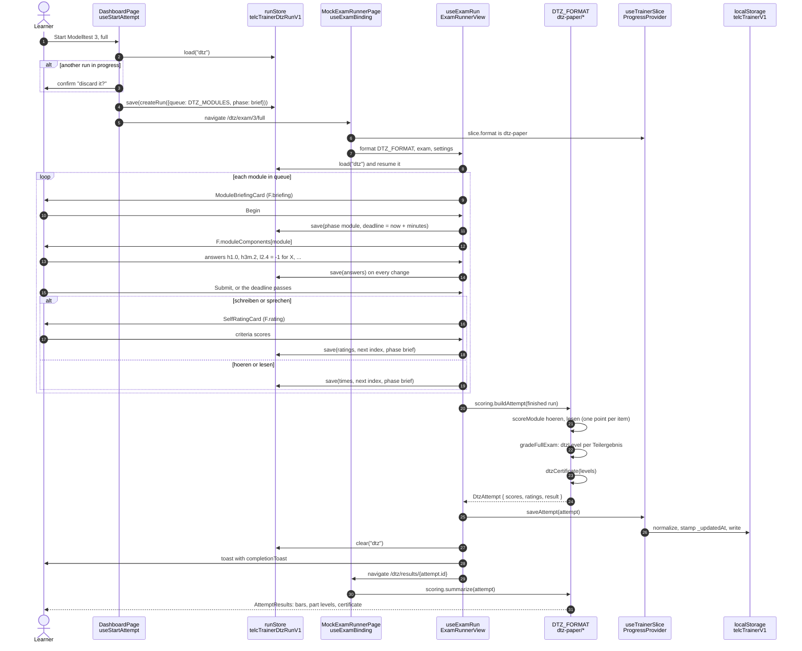
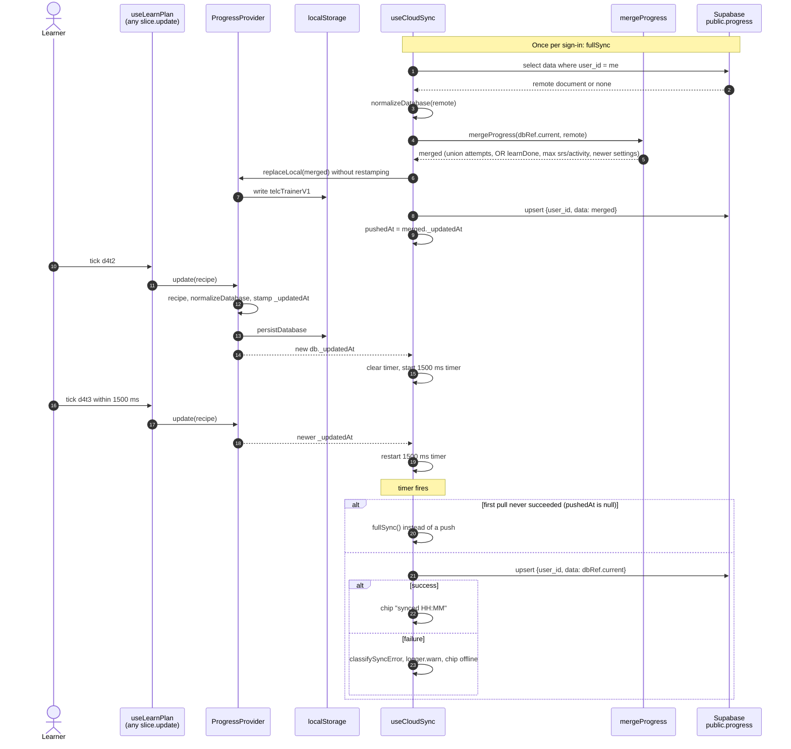
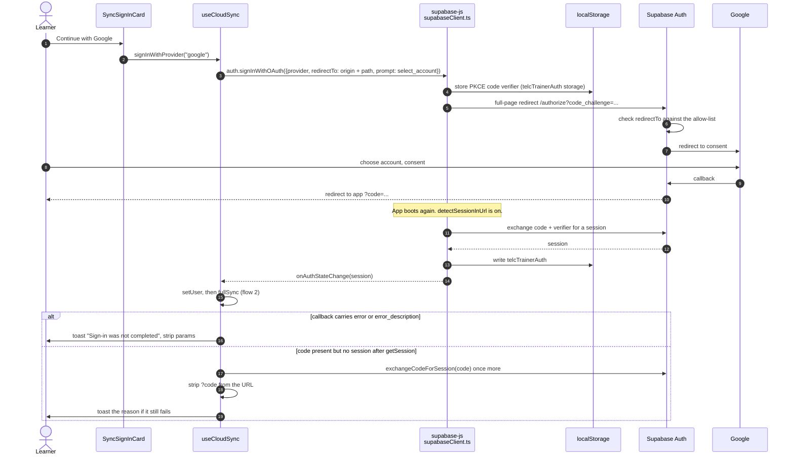
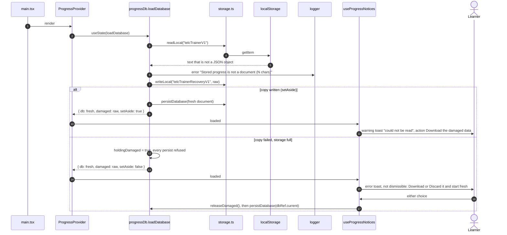
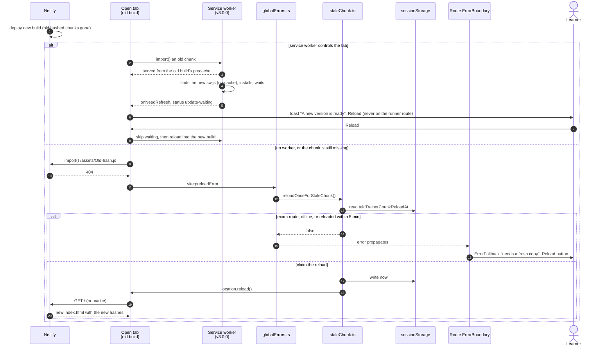

# C4 dynamic views

Five flows, step by step. Participant names are the real functions and files.

- [1. Sitting a full DTZ exam](#1-sitting-a-full-dtz-exam)
- [2. A local change reaches the cloud](#2-a-local-change-reaches-the-cloud)
- [3. Google sign-in through a PKCE redirect](#3-google-sign-in-through-a-pkce-redirect)
- [4. Boot with a corrupt stored document](#4-boot-with-a-corrupt-stored-document)
- [5. A deploy, a stale chunk, one reload](#5-a-deploy-a-stale-chunk-one-reload)

## 1. Sitting a full DTZ exam

A full DTZ sitting runs four modules: `hoeren`, `lesen`, `schreiben` and `sprechen`
(`DTZ_MODULES`). Hören and Lesen are marked against the key, one point per item. The
learner rates Schreiben and Sprechen on the paper's criteria. The certificate comes from
three Teilergebnisse, not from a total.

**The thresholds.** They are in `DTZ_PART_LINES` (`shared/config/dtzExam.ts`) and follow
the g.a.s.t. _Übungssatz 1_ marking:

| Teilergebnis  | B1 from | A2 from | Max |
| ------------- | ------- | ------- | --- |
| Hören + Lesen | 33      | 20      | 45  |
| Schreiben     | 15      | 7       | 20  |
| Sprechen      | 75      | 35      | 100 |

**The certificate rule (`dtzCertificate`).**

1. Sprechen below A2 rules out any certificate.
2. Zertifikat B1 needs Sprechen at B1 and either Hören + Lesen or Schreiben at B1.
3. Otherwise, Zertifikat A2 needs Sprechen at A2 or above and either written result at A2 or
   above.
4. Otherwise, the result is "unter A2".

**What is stored.** The attempt stores only the scores and `result`. The part levels are
derived from `scores` each time they are shown. The source does not state how many times a
Hören text is played, so the play count is an app setting (`playsAllowed`). It is never
presented as official.

**The clock.** It is an absolute `deadline`, so a reload in the middle of a module resumes
with the right time left. A run naming a module that the paper lacks sends the learner home.

## 2. A local change reaches the cloud

Every write goes to `localStorage` first. Sync runs only when a user is signed in.

- **No overwrite before a merge.** The push is gated on a completed pull, so a device never
  writes over a remote document it has not merged. The `online` event retries a failed sync.
- **Offline is not an error.** An offline failure shows in the header badge and raises no
  toast. Other failures raise a toast with Retry.
- **Delete is not a merge.** The union-only merge cannot express a deletion. "Delete all
  progress" first calls `clearRemote(empty)`, which upserts a stamped empty document and reads
  the row back (RLS has no delete policy, so `.delete()` would silently remove nothing); the
  browser is emptied only after that succeeds.
  See the caveat in the [data model](data-model.md#merge-rules).

## 3. Google sign-in through a PKCE redirect

**Why the flow is safe.**

- **No token in the URL.** PKCE keeps tokens out of the URL. The redirect carries a
  single-use code, and only the browser that holds the verifier can exchange it.
- **The redirect target cannot be redirected.** `redirectTo` is built from the page's own
  origin, and Supabase's redirect allow-list is the second gate.
- **No popup.** `Cross-Origin-Opener-Policy: same-origin` is safe because sign-in is a
  full-page redirect, never a popup.

## 4. Boot with a corrupt stored document

**The original is never overwritten silently.** An earlier build loaded a broken document
as an empty one. The next write then saved that empty document over the original. Now:

- the damaged bytes are copied aside before anything is written;
- if the copy cannot be made, the learner chooses what happens before any write.

**A full disk is handled the same way.** `writeLocal` returns `Result<void>` and tells its
failure listeners. The provider then toasts "Storage is full" with an "Export a backup"
action. Later reads see this tab's in-memory copy first.

## 5. A deploy, a stale chunk, one reload

- **The guard stores a timestamp in `sessionStorage`.** It survives the reload it caused,
  so a chunk that is still missing cannot cause a reload loop.
- **It never reloads during an exam sitting.** The run is saved, but a page that vanishes
  in the middle of a module is alarming. The learner chooses the moment with the fallback's
  Reload button.
- **It never reloads while offline.** A reload would land on the browser's offline page.
- **Dev builds use the boundary.** They fire no `vite:preloadError`, so the boundary's
  `reportRenderError` is the only path there.
