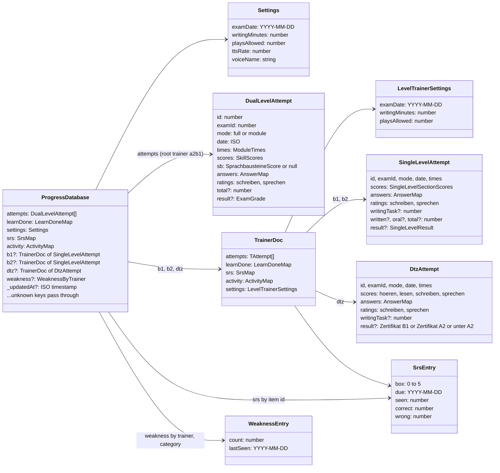

# Data model

Everything the learner has done lives in **one JSON document**, `ProgressDatabase`
(`src/shared/types/progress.ts`), under the `localStorage` key `telcTrainerV1`. When the
learner is signed in, the same document is the `data` column of their one row in Supabase
`public.progress`. Exam sittings in progress live under three separate run keys. The
schedule is never stored: it is derived from `settings.examDate`, `learnDone` and the
attempt list.

## The progress document

### Slices

The registry decides where each trainer's work is stored (`TRAINERS[id].docKey`):

| Trainer | `format`       | `docKey` | Where its slice lives                                                                                   | Attempt type         |
| ------- | -------------- | -------- | ------------------------------------------------------------------------------------------------------- | -------------------- |
| `a2b1`  | `dual-level`   | `null`   | The document root: `attempts`, `learnDone`, `srs`, `activity`, `settings` (with `ttsRate`, `voiceName`) | `DualLevelAttempt`   |
| `b1`    | `single-level` | `'b1'`   | `db.b1`                                                                                                 | `SingleLevelAttempt` |
| `b2`    | `single-level` | `'b2'`   | `db.b2`                                                                                                 | `SingleLevelAttempt` |
| `dtz`   | `dtz-paper`    | `'dtz'`  | `db.dtz`                                                                                                | `DtzAttempt`         |

`useTrainerSlice(trainer)` returns one discriminated `TrainerSlice` (on `format`) whichever
place holds it, so no screen tests a trainer id. Only two files may name trainer ids as
values: `progressDb.ts` (`EMPTY_DATABASE`, `normalizeDatabase`) and `mergeProgress.ts`.
Under `exactOptionalPropertyTypes`, an unopened trainer must be an absent key, so both files
spell each trainer out.

`weakness` is keyed by trainer at the root for every trainer, including A2·B1. It is
normalised and merged, but in this tree nothing in `src/` writes it yet (only
`shared/writing-feedback/lib/weaknessProfile.ts` and its tests touch the shape).

### `normalizeDatabase`

`normalizeDatabase` (`src/shared/progress-store/lib/progressDb.ts`) runs on every load,
every write and every remote document before a merge:

1. It spreads the input first, so **unknown keys pass through**. A newer build's field
   survives an older build.
2. It validates each known field by shape and defaults anything wrong:
   - an array for `attempts`;
   - a non-null, non-array object for a map (`isMap`);
   - defaults merged into `settings`;
   - a trainer document for each of `b1`, `b2` and `dtz`.
3. It **returns the caller's own nested object when nothing in it changed** (`withDefaults`,
   `unchanged`). Consumers memoise on those references.

A chosen import file gets the opposite treatment. `readBackup` in `importProgress.ts`
refuses the whole file when a slice field has the wrong type, and names the field. A stored
document is repaired; a file the learner chooses is refused.
[ADR 0004](adr/0004-no-schema-library.md) explains why neither one uses a schema library.

## Storage keys

These keys are user data. **Never rename or remove one.**
`.claude/hooks/storage-keys.baseline` lists them, and `npm run check:storage-keys` fails on
pre-push, in CI and in the PostToolUse hook if one disappears from `src/`. A new key is
added with `npm run check:storage-keys -- --update`.

| Key                        | Store          | Holds                                                                                          | Defined in                                |
| -------------------------- | -------------- | ---------------------------------------------------------------------------------------------- | ----------------------------------------- |
| `telcTrainerV1`            | localStorage   | The `ProgressDatabase`                                                                         | `progress-store/lib/progressDb.ts`        |
| `telcTrainerRecoveryV1`    | localStorage   | The most recent stored text that was not a document, copied byte for byte before a fresh start | `progress-store/lib/progressDb.ts`        |
| `telcTrainerRunV1`         | localStorage   | `dual-level` runs (A2·B1)                                                                      | `exam-run/lib/dualLevelRunFormat.ts`      |
| `telcTrainerLevelRunV1`    | localStorage   | `single-level` runs, one entry each for B1 and B2                                              | `exam-run/lib/singleLevelRunFormat.ts`    |
| `telcTrainerDtzRunV1`      | localStorage   | `dtz-paper` runs                                                                               | `exam-run/lib/dtzPaperRunFormat.ts`       |
| `telcTrainerAuth`          | localStorage   | The Supabase session; supabase-js also keeps the PKCE verifier beside it during a sign-in      | `account-sync/lib/supabaseClient.ts`      |
| `telcTrainerTheme`         | localStorage   | `light` or `dark`; when it is absent, the app follows `prefers-color-scheme`                   | `shared/hooks/useTheme.tsx`, `index.html` |
| `telcTrainerSessionLogV1`  | sessionStorage | The redacted diagnostics log of this tab                                                       | `shared/lib/logger.ts`                    |
| `telcTrainerChunkReloadAt` | sessionStorage | When the stale-chunk guard last reloaded                                                       | `shared/lib/staleChunk.ts`                |

### Run stores

Each run key holds a map `{ [trainerId]: ExamRun }`. `parseRuns` in `runStore.ts` still
reads two older shapes:

- a bare run (what `telcTrainerRunV1` always held);
- zustand's `{ state: { run }, version }` envelope, which named the trainer `level`.

It files each one under its trainer. An entry is refused if its `trainer` disagrees with
the key it sits under, or if its queue names a module that does not exist. A key with no
runs left is removed. An `ExamRun` holds `runId`, `trainer`, `examId`, `mode`, `queue`,
`index`, `phase` (`brief`, `module` or `rating`), `answers`, `times`, `plays`, `ratings`,
`deadline` (an absolute epoch ms) and `moduleStart`.

## Answer keys

`AnswerMap` is flat and stringly keyed: `<module letter><Teil>.<index>` → number, boolean or
string. It is persisted in runs and attempts and read by older and newer builds alike, so
**the key format never changes**. Values are read through `shared/lib/answers.ts`
(`numberAnswer`, `booleanAnswer`, `textAnswer`, `itemKey`).

| Paper                   | Lesen                                                                                                                                         | Sprachbausteine | Hören                                                                                                            | Schreiben                                |
| ----------------------- | --------------------------------------------------------------------------------------------------------------------------------------------- | --------------- | ---------------------------------------------------------------------------------------------------------------- | ---------------------------------------- |
| `dual-level` (A2·B1)    | `l1.n` … `l4.n`                                                                                                                               | `s1.n` … `s3.n` | `h1.n` … `h5.n` (`h5` holds note-sheet text, compared loosely)                                                   | `w.text`                                 |
| `single-level` (B1, B2) | `l1.n` … `l3.n`                                                                                                                               | `s1.n`, `s2.n`  | `h1.n` … `h3.n`                                                                                                  | `w.text`, `w.task` (B2 offers two tasks) |
| `dtz-paper` (DTZ)       | `l1.0–4` a/b/c · `l2.0–4` ad a–h **or `-1` for X** · `l3.0–2` richtig/falsch + `l3m.0–2` a/b/c · `l4.0–2` richtig/falsch · `l5.0–5` gap a/b/c | none            | `h1.0–3` a/b/c · `h2.0–4` a/b/c · `h3.0–3` richtig/falsch + `h3m.0–3` a/b/c per Gespräch · `h4.0–2` sentence a–f | `w.text`, `w.task` (Aufgabe A or B)      |

- **Values.**
  - An option index is a `number` (a = 0).
  - richtig/falsch is a `boolean`.
  - Text is a `string`.
  - `NO_MATCH_ANSWER = -1` is DTZ Lesen Teil 2's X ("no ad fits"). It is a number, so it
    travels in the same map.
- **DTZ numbering.** `dtz-paper/items.ts` flattens a DTZ paper into its 45 numbered items:
  Hören 1–20, Lesen 21–45. Scoring, the unanswered count and the review all walk that one
  list, so the three cannot disagree on an item's key.
- **Ratings.** The two self-rated modules store `ratings.schreiben` and `ratings.sprechen`.
  For the DTZ, those are points out of 20 and 100.

## `learnDone` keys

`learnDone` is `{ "d<day>t<index>": true }`, built by `learnTaskKey(day, taskIndex)` in
`shared/lib/learnProgress.ts`. For example, `d7t2` is day 7, task 2 (zero-based). A key
names a position, not a task. Adding, removing or reordering a curriculum day or task
therefore re-points ticks that learners already made. **Rewrite task text in place; never
renumber.**

## Merge rules

`mergeProgress(local, remote)` (`src/shared/account-sync/lib/mergeProgress.ts`) runs on each
sign-in sync. The newer side is decided by `_updatedAt` (`local >= remote` means local).

| Field                                   | Rule                                                                                                                    | Why                                                                             |
| --------------------------------------- | ----------------------------------------------------------------------------------------------------------------------- | ------------------------------------------------------------------------------- |
| `attempts` (root and each `TrainerDoc`) | Union by `id`, sorted by `id`                                                                                           | Attempts are immutable once written                                             |
| `learnDone`                             | Only `true` entries survive, from either side (OR)                                                                      | Unticking on one device must not undo work done on another                      |
| `srs`                                   | Per item: the entry with the higher `box` (local on a tie); `due` = the later date; `seen`, `correct` and `wrong` = max | Boxes only rise through correct answers; the counters are monotone              |
| `activity`                              | Per date: max                                                                                                           | Syncing twice must not inflate a streak                                         |
| `settings` (root and each `TrainerDoc`) | Shallow spread, newer side's keys win                                                                                   | Last write wins                                                                 |
| `weakness`                              | Per trainer, per category: `count` = max, `lastSeen` = the later date; both sides' trainer keys are walked              | Same reason as `activity`; keeps profiles for trainers this build does not know |
| `b1`, `b2`, `dtz`                       | `mergeTrainerDoc`, the rules above per field; if one side lacks the slice, the other side's is taken whole              | Each trainer document is merged like the root                                   |
| Unknown keys                            | Taken from the newer side, at the root and inside each trainer document                                                 | An older build must not delete a newer build's data                             |
| `_updatedAt`                            | The newer side's                                                                                                        |                                                                                 |

**Adding a field to `ProgressDatabase` takes three edits:**

1. `normalizeDatabase` defaults it.
2. `mergeProgress` merges it.
3. A test asserts that the merged, serialised payload keeps it.

The B1/B2 slices were once lost because the second edit was missing.

**Consequences of a union-only merge.**

- **No deletion.** The merge cannot express a deletion, and the browser cannot remove the
  row either: `supabase-setup.sql` defines select, insert and update policies but **no
  delete policy**, so under row-level security a `.delete()` matches no row and returns no
  error. "Delete all progress" therefore runs `clearRemote(empty)` (`useCloudSync`)
  **before** it touches the browser: it upserts a fresh empty document, stamped now, over
  the row, then reads the row back and succeeds only if the stored copy carries that stamp
  and no attempts. Any failure (offline, RLS refusal, rate limit, a read-back that still
  holds the old copy) deletes nothing in the browser and says "The cloud copy could NOT be
  cleared" and why; if the write landed but the read-back failed, it says the row was
  overwritten but not checked. On any failure the browser's document is
  re-stamped, so it is the newer side: the write may have landed (a lost response, a failed
  read-back), and an emptied row that stayed newer would hand its default settings to the next
  merge. The debounced push then puts the whole document back. While it runs no sync or push may start, and any already on
  the wire is awaited first, so none can land after the read-back. Only then are the local document and every run emptied, with the
  same document, so nothing is left to push and the next sync has nothing old to merge in.
- **Known limit: other devices.** An empty, newer document does not remove anything from a
  union. Another signed-in device — or another open tab on this one, which nothing tells
  about the change — keeps its own full copy. Its next sync merges: attempts, ticks, SRS,
  activity and weakness come back (unions), while settings take the cleared defaults because
  the empty document is newer. Its next push is a blind upsert and puts its whole document
  back, settings included. Either way the cloud row, and from there this browser, refills.
  The Settings dialog says so: other signed-in devices (and other open tabs) keep their own
  copy until you clear them too. Fixing it needs a deletion marker in the document and a
  merge that honours it — a schema change, not done.
- **Older builds and the `dtz` slice.** A pre-3.0 build does not know `dtz`. It treats the
  slice as an unknown key and carries it whole from whichever side is newer. A device still
  on a cached pre-3.0 build can therefore overwrite the cloud copy of the DTZ **settings**.
  DTZ attempts and ticks come back on the next 3.0 sync, because that merge is a union.

## Import and export

- **Export.** `useProgressBackup` writes the whole in-memory document as JSON.
- **Import** goes through `readBackup`, which returns a `Result`. The restore is then
  planned per slice by `importProgress.ts`:
  - a slice the file carries replaces the stored one, even if it is empty;
  - a slice the file does not mention keeps what is stored.
- **Why per slice.** An old backup made before B1 and B2 existed once emptied both trainer
  documents. The fresh `_updatedAt` then pushed that emptiness to every device.
