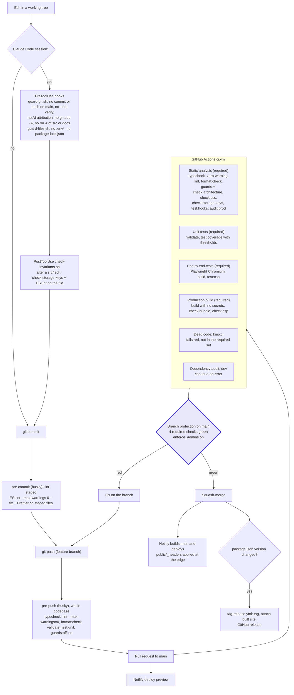

# Quality gates

A change reaches learners only through a series of gates. Each gate catches a different
class of mistake. Only one gate is a security boundary: GitHub branch protection, which is
enforced on the server. Everything that runs on a developer's machine, Claude Code hooks
included, can be bypassed and exists to catch accidents early.

## The gates

| Gate                             | Where                                              | Catches                                                                                                                                                                                              | Bypassable?                                                                                  |
| -------------------------------- | -------------------------------------------------- | ---------------------------------------------------------------------------------------------------------------------------------------------------------------------------------------------------- | -------------------------------------------------------------------------------------------- |
| `guard-git.sh`, `guard-files.sh` | `.claude/hooks/`, wired in `.claude/settings.json` | A Claude session committing to `main`, skipping hooks, adding AI attribution, staging everything, or editing `.env` or the lockfile                                                                  | Yes. It is accident prevention ([ADR 0012](adr/0012-claude-hook-not-a-security-boundary.md)) |
| `check-invariants.sh`            | PostToolUse hook                                   | A removed storage key or a lint error, right after the edit that caused it                                                                                                                           | Yes                                                                                          |
| pre-commit                       | `.husky/pre-commit`, `.lintstagedrc.json`          | Formatting and lint in the staged files                                                                                                                                                              | Yes (`--no-verify`)                                                                          |
| pre-push                         | `.husky/pre-push`                                  | Type errors and lint anywhere, broken exam data, failing unit and render tests, architecture and storage-key violations. It checks the working tree, not the pushed commit.                          | Yes                                                                                          |
| CI `static`                      | `.github/workflows/ci.yml`                         | The same static gates, plus `audit:prod` (moderate and above fails)                                                                                                                                  | No: required                                                                                 |
| CI `unit`                        | `ci.yml`                                           | `validate.cjs` (every mock exam against its paper), all vitest suites, and coverage thresholds on libs and hooks (they only ratchet up)                                                              | No: required                                                                                 |
| CI `e2e`                         | `ci.yml`                                           | Real-browser flows: a11y (axe), keyboard-only, contrast, auth with stubbed Supabase, DTZ, exam, schedule; then the production build served with its real `_headers` and failing on any CSP violation | No: required                                                                                 |
| CI `build`                       | `ci.yml`                                           | A build that depends on a local `.env`; entry chunk over baseline + 10%; a `content-<id>` chunk over 160 kB gzip; a stale CSP hash                                                                   | No: required                                                                                 |
| CI `deadcode`                    | `ci.yml`                                           | Unused files, exports and dependencies (knip)                                                                                                                                                        | Shows red, but is not in the required set                                                    |
| CI `audit`                       | `ci.yml`                                           | Dev-dependency advisories                                                                                                                                                                            | Report only (`continue-on-error`)                                                            |
| Branch protection                | GitHub, server-side                                | Any merge to `main` without the four required checks green. `enforce_admins` has been on since 2026-10-12, so admins cannot merge past red either.                                                   | **No. This is the boundary.**                                                                |

## What each guard script checks

- **`check:architecture`** (`scripts/check-architecture.mjs`):
  - no `index.*` and no `routes/` folder;
  - every feature has `pages/`;
  - every `PascalCase.tsx` sits in a folder of its own name;
  - no `use*.ts` (hooks are `.tsx`);
  - no feature imports another;
  - no two `.tsx` files share a basename.
- **`check:css`** (`scripts/check-css-tokens.mjs`): no raw colour in CSS outside the token
  blocks of `src/styles/index.css`.
- **`check:storage-keys`** (`scripts/check-storage-keys.mjs`): every key in
  `.claude/hooks/storage-keys.baseline` still appears in `src/`.
- **`test:hooks`** (`scripts/test-claude-hooks.sh`): the Claude Code hooks block and allow
  what they should. A broken hook must not block every Bash call.
- **`validate`** (`validate.cjs`): every `src/content/<id>/exams/examNN.ts`, against the
  paper it declares with `satisfies`.
- **`check:bundle`** (`scripts/check-bundle-size.mjs`): the entry chunk is at most
  `ENTRY_BASELINE_BYTES` + 10%, and every `content-<id>` chunk is at most 160 kB gzip.
- **`check:csp`** (`scripts/check-csp.mjs`): the `script-src` hashes in `public/_headers`
  match the inline scripts in the built `index.html`.

## Rules that are ESLint rules

Many conventions are lint errors, not review comments, so the pre-push hook and CI catch
them:

- the layer import rules;
- no barrels;
- no trainer id outside the registry and the two persistence files;
- `components-visual-only` ([ADR 0007](adr/0007-components-visual-only.md));
- `no-raw-html-controls` and `local/no-raw-colours`;
- `local/no-classes` and `local/no-swallowed-catch`;
- strict `jsx-a11y`.

The `no-restricted-imports` and `no-restricted-syntax` entries are configured, not
accumulated: a later flat-config entry replaces the earlier options. Each entry therefore
restates every pattern that applies to its files.

## Releases

Releases happen in two phases, because branch protection does not let a workflow push to
`main`:

1. **`release.yml`** is started by hand. It verifies `main`, bumps `package.json`, and
   opens a `release/vX.Y.Z` pull request.
2. **`tag-release.yml`** runs when a `package.json` change lands on `main`. It tags the
   commit, builds the site and attaches the build to a GitHub release.

The footer shows the version through `__APP_VERSION__`, which is set in `vite.config.ts`.
